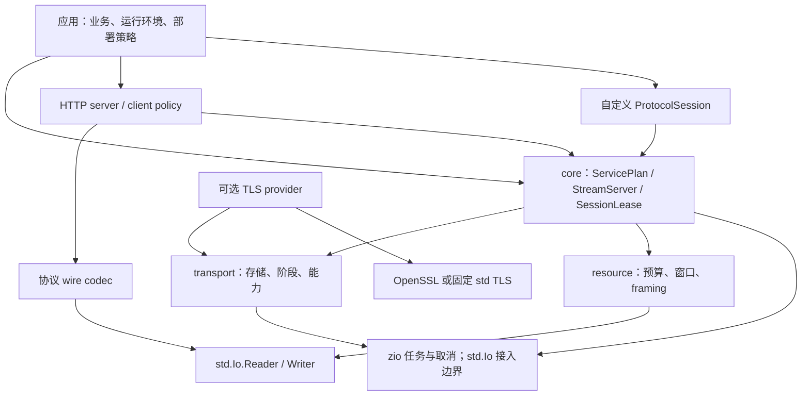
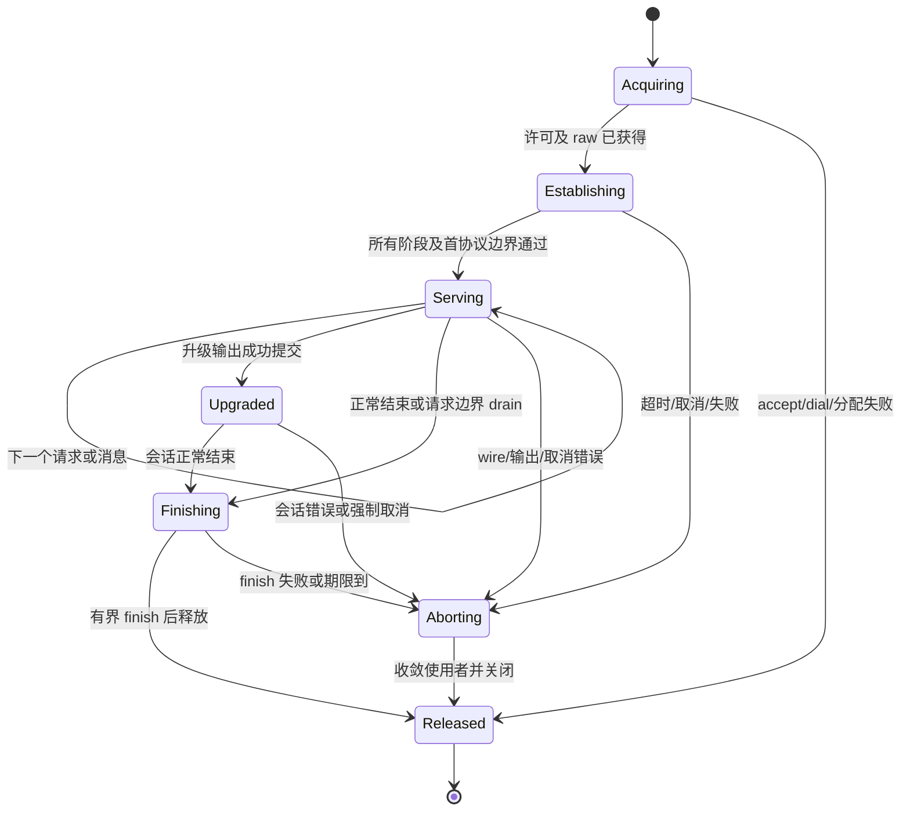

# Talon 网络引擎：设计评估与新一轮建模

状态：设计提案，尚未实施。评估日期：2026-10-09。基线：`main`，HEAD `54a15b2`，包含本次评估开始前已有的暂存、未暂存和未跟踪内容。适用版本：Talon 包版本 0.1.0、Zig 0.16.0、zio v0.18.0。

本文面向维护者和协议实现者，回答“保留什么、改变什么、谁拥有资源、如何逐步验证”。[竞品配套分析](network-engine-competitors.md) 提供跨语言依据；[当前架构](../talon-architecture.md) 和已有主题设计继续描述现有实现。本文与配套文档沿用 `docs/design/` 约定，不替换现状文档，不将拟议 API 写成已实现能力。

## 1. 结论与定位

**建议将 Talon 定位为：由应用提供运行环境、以有界资源和结构化任务作用域为基础、通过编译期组合承载流式协议的 Zig 网络引擎。** HTTP/1.1、WebSocket、SSE 是这一引擎的协议包。路由、身份授权、业务服务和进程控制由上层应用承担。

当前 `core → http.codec → http.server/client` 的大方向合理，已有许可背压、确定性内存传输、显式分配器、期限拒绝和失败回滚。新一轮设计应保留这些深模块，集中解决下列修改成本来源：

1. 建连顺序固定，无法直接组合常见的“明文 PROXY v2 → TLS → 应用协议”；需要把建立阶段变成有明确所有权的静态计划。
2. 传输契约通过散布的 `@hasDecl`、`@hasField` 和惯例推断，服务端/客户端重复解释固定地址、期限和错误存储；需要统一语义与契约检查，不强行合并两端生命周期。
3. 借用对象和拥有对象的 API 外观相近；`Response.deinit()` 还会执行网络 drain。需要让释放、可挂起结束、所有权转移在接口中显式区别。
4. 运行时、协议 codec 和会话调度的边界不完全一致。需要明确 `std.Io`、Reader/Writer 与 zio 各负责什么，为标准 I/O 接入保留可验证的演进路径。
5. 资源限额和可观测指标已较丰富，但作用域、停机状态和身份可信度仍主要依赖调用方掌握隐含规则。需要把它们纳入状态模型和不变量。

这里将“完全遵从 Zig 语言特色”操作化为：显式依赖和分配、可追溯的生命周期、编译期静态组合、错误值与失败清理、标准字节流接口、可控动态派发，以及平台能力的显式拒绝。Zig 没有唯一官方网络架构；使用 zio、函数指针或必要的堆分配本身不违背这些特征。不能以“纯 Zig”“零成本”标签代替以上契约。

范围假设来自 README 和 RESP 示例：先服务于 TCP 等可靠字节流及现有 HTTP 协议，不把本轮变成 UDP、HTTP/2/3、完整 Web 框架或代理产品开发。若主要目标其实是大规模反向代理或每核分片数据服务，第 11 节的决策需要重审。

## 2. 证据与现状

### 2.1 证据口径

“事实”表示在当前源码、构建配置或直接读取的官方资料中可定位；“判断”表示基于这些事实的设计评价；“提案”表示本文建议的新模型；“待验证”表示需要实验或实际消费者才能判断。已有测试文件只证明有检查入口，不能自动证明本轮运行通过。

本轮执行 `zig version` 得到 `0.16.0`，并执行 `zig build check --summary all`，结果为 5/5 构建步骤成功，三个默认 Debug 原生测试目标编译成功，均使用缓存。这不是运行测试、TLS 验收或性能结果。已有 [验证记录](../benchmarks/validation.md) 是另一份执行证据，本文不把其中结果计为本轮重跑。

### 2.2 当前模块与数据流

| 边界           | 已验证实现                                                                               | 主要证据                                                                                                                                                    |
| -------------- | ---------------------------------------------------------------------------------------- | ----------------------------------------------------------------------------------------------------------------------------------------------------------- |
| 包入口         | 单一 `talon` 模块，core 与 http 相对导入；顶层保留便利别名                               | [talon.zig](../../src/talon.zig)、[build.zig](../../build.zig)                                                                                              |
| 流式服务引擎   | accept 前申请许可，独立 accept 任务，连接 Group，adapter、middleware、握手、serve、drain | [stream_server.zig](../../src/core/stream_server.zig)                                                                                                       |
| 连接与传输     | value/pinned 两种 I/O 存储，完整 flush、期限能力、稳定地址、受检 detach                  | [connection.zig](../../src/core/connection.zig)、[listener.zig](../../src/core/listener.zig)                                                                |
| 内存与 framing | 池窗口、requested-bytes 预算、借用分帧与拥有型大帧、可控制 Pipe 背压                     | [buffer_pool.zig](../../src/core/buffer_pool.zig)、[allocation_budget.zig](../../src/core/allocation_budget.zig)、[framing.zig](../../src/core/framing.zig) |
| HTTP 服务端    | 请求头复制至 arena；线性请求循环；限额、body drain、响应提交与同步升级                   | [protocol.zig](../../src/http/server/protocol.zig)、[request.zig](../../src/http/server/request.zig)、[response.zig](../../src/http/server/response.zig)    |
| HTTP 客户端    | Connector、连接存储和 Pool；全局/origin 准入；逻辑请求级期限与头预算；重试/重定向/解码   | [client.zig](../../src/http/client/client.zig)、[pool.zig](../../src/http/client/pool.zig)、[connection.zig](../../src/http/client/connection.zig)          |
| 长连接会话     | WS 单 reader、消息/帧写入同步、出站额度与分片；SSE 流及重连                              | [ws.zig](../../src/http/codec/ws.zig)、[sse.zig](../../src/http/codec/sse.zig)                                                                              |
| TLS            | 客户端 std TLS 兼容副本；服务端可选 OpenSSL memory BIO，默认不链接 OpenSSL               | [tls.zig](../../src/http/client/tls.zig)、[vendor 说明](../../src/http/client/vendor/README.md)、[tls_server.zig](../../src/tls_server.zig)                 |

服务端路径是 `许可 → accept → ConnTask → adapter.wrap → 租窗口 → Connection → middleware → 可选 Proto.handshake → Proto.serve`。HTTP 在同一连接任务中按顺序处理请求；pipeline 是连续请求读取和响应缓冲复用，不等于并行处理同一 HTTP/1.1 连接上的请求。WS 升级在该任务内运行，不自动生成脱离引擎追踪的会话。

客户端路径是 `逻辑请求 policy → Pool 准入/checkout → Connector.connect（必要时）→ 编码 → 响应头 → body/decoder → Response 释放 → checkin 或销毁`。活跃许可覆盖响应正文、SSE 和 WS 所有权，而不是收到响应头就归还。

### 2.3 软件设计哲学评价

评价采用复杂度优先、深模块、信息隐藏、变更集中和清晰失败路径。理论参考为 John Ousterhout 的 [A Philosophy of Software Design](https://web.stanford.edu/~ouster/cgi-bin/book.php)；以下结论是针对 Talon 的工程判断，不是对书籍逐条套用。

**值得保留的深模块：** StreamServer 隐藏许可、任务、取消与关闭回滚；Pool 隐藏双维度准入与空闲复用；TLS adapter 隐藏固定地址状态和 BIO；Http1Protocol 隐藏 framing、arena 与响应提交。调用者表达“服务连接”“获取响应”，不用重建内部计数。RESP 示例说明 core 已有真实的非 HTTP 使用路径。

**值得保留的非统一：** 请求 arena 与客户端响应 arena 的释放时机不同；连接中间件、请求中间件和 wire 编解码不是同一概念；HTTP 限额不应下沉为 core 的协议知识。共同规则可集中，共同外观不构成合并理由。

**复杂度信号：** 用户必须知道对象不可移动、哪个 `deinit` 会挂起、adapter 成功前后谁关 raw、错误被 Reader/Writer 包装后如何查原因，以及可选方法之间的组合要求。这些知识横跨多文件，容易使新 transport 编写者重建引擎内部判断。减少这类知识比增加更多模块层数更有价值。

### 2.4 问题与处置优先级

下表是设计问题清单，不将未运行的组合推断称为复现缺陷。

| 优先级         | 源码事实与影响                                                                                              | 建议及验证                                                                                   |
| -------------- | ----------------------------------------------------------------------------------------------------------- | -------------------------------------------------------------------------------------------- |
| 高：建立顺序   | `prepareTransport` 先 wrap，随后 `ConnChain` 才解析 PROXY；常见外层 PROXY 前缀会先交给 TLS                  | 引入建连静态计划，测试 PROXY/TLS 同包预读、碎片、超时和失败关闭                              |
| 高：I/O 契约   | server `Connection` 和 client `Transport` 各解释 pinned/value、期限与错误；能力推断依赖方法/字段惯例        | 共用 capability/diagnostic/flush 语义及契约检查；保留各自 owner，做同一 conformance suite    |
| 高：借用与拥有 | Request/headers/frames 借用，Response 占活连接；Zig 类型系统不阻止复制 owner 或返回借用指针                 | 文档与命名区别 view/owner；稳定地址发布；转移后清空原 handle；Debug 检查但不声称线性类型保证 |
| 高：结束语义   | 客户端 `Response.deinit` 调 `finishResponse`，后者 drain body；禁用期限时清理可能等待对端                   | 新 API 分离显式有界 finish 与无网络等待的 abort/release；旧语义通过兼容周期迁移              |
| 中：codec 边界 | `http/codec/ws.zig` 同时有帧/UTF-8 逻辑和 zio mutex、取消、发送准入                                         | 按“wire 规则”与“会话协调”拆责任；不按文件行数机械拆分                                        |
| 中：配置与状态 | 多处重新映射 policy；仅部分资源变更在 serve 时拒绝；shutdown flags 留存在 server                            | 启动前编译/验证计划；运行配置按契约冻结；明示单次 serve 状态，重复运行必须重新初始化         |
| 中：身份可信度 | PROXY middleware 覆盖 effective remote；它本身不建立发送者可信授权                                          | 独立 transport peer、asserted peer 与来源；应用配置可信入口，在 TLS 之前识别原 TCP peer      |
| 中：资源与锁   | 默认 `max_connections=65536`；池有自旋锁，元数据增长可在锁内分配；栈不计入 allocator 预算                   | 明确容量估算和 allocator 契约，测临界区/多执行器争用；有证据才改锁或分片                     |
| 低：命名与入口 | 顶层 `talon.Limits` 是 HTTP Limits，core 的通用 Limits 则在另一位置；chain 注释提到未实现 datagram consumer | canonical API 使用 `talon.core`/`talon.http`；兼容别名逐步弃用，修正能力与注释的范围         |

`deinit` 问题的范围需精确理解：默认普通请求有读和逻辑总期限，不能断言默认所有清理都无限等待；风险集中于显式禁用期限、长流政策，以及“释放会执行 I/O”这一隐藏成本。

## 3. Zig 特征对架构的约束

### 3.1 语言、标准库和运行时是三层

Zig 0.16 已用 `std.Io` 将网络、时间、同步、异步任务等不确定操作抽象为显式依赖。Reader/Writer 是缓冲字节流接口，可用于纯内存编解码；它们不是任务调度器。当前 Talon 的 `zio.spawn/Group/Timeout/Mutex` 仍直接选用 zio 的运行上下文，不能因使用 std Reader 就声称支持任意 std.Io backend。

[Zig 0.16 发布说明](https://ziglang.org/download/0.16.0/release-notes.html) 区分：`Io.Threaded` 是功能完整、经过测试的实现；`Io.Evented` 是实验性工作；`Io.Uring/Kqueue` 尚有不完整部分。`Io.async` 与 `Io.concurrent` 的执行/并发要求也不同。不要把 std 异步函数、zio 协程、Rust `async/await` 当成同一语言机制。

[zio v0.18.0](https://github.com/lalinsky/zio/blob/v0.18.0/README.md) 已提供 `Runtime.io()` 对接 std.Io，运行时以有栈协程、事件循环和可选跨执行器迁移实现并发。默认执行器数在本次依赖源码为 1；多执行器配置不是 Talon 自动获得的性能保证。

### 3.2 设计映射

| Zig 特征                          | 对 Talon 的具体要求                                                                       | 不宜照搬的模式                                                   |
| --------------------------------- | ----------------------------------------------------------------------------------------- | ---------------------------------------------------------------- |
| 显式 allocator，无 GC             | 调用方选择分配策略；每个 arena、窗口、TLS state 都有 owner 和销毁点；OOM 正常进入错误路径 | 全局 allocator、GC 风格无限缓存、隐藏 `alloc` 的便利层           |
| 切片和指针，无 borrow checker     | 区分窗口借用与独立拥有；异步任务 join 后才能 reset/free；`const` 不延长寿命               | 用不可变切片伪装所有权，用引用计数代替所有生命周期设计           |
| 值语义、可复制 struct             | 发布自引用 I/O 前固定最终地址；避免把已发布的 Session/Pool/预算按值返回或复制             | 假定 struct 是不可复制 owner、假定栈地址永远可移交               |
| 错误联合、`try`、`defer/errdefer` | 保留明确 error set；部分初始化 rollback；取消/输出污染作为终止原因                        | 只返回 bool、吞取消后继续工作、统一异常字符串                    |
| `comptime`/`anytype`              | 组合 Proto/transport/静态链；在入口校验必要声明、签名和能力，给领域化编译错误             | 把 Java 类型层级翻成多级 Zig 包装，把所有 policy 固化到编译期    |
| 函数指针与 `anyopaque`            | 仅在标准 I/O、必要运行时选择和可观测 sink 使用小型动态边界；记录 userdata 寿命            | “用了 vtable 就不 Zig”，或为每个组件建立插件注册表               |
| `std.Io` 显式依赖                 | 可变环境由应用提供；逐步让时间/随机/任务使用一个明确运行环境                              | core 内隐式启动全局 runtime，或用两套不相关时钟计算一个 deadline |
| C ABI 与构建系统                  | OpenSSL 保持显式可选，使用 build-time translate-C；target 能力在构建/启动时拒绝           | 让所有用户都承担 TLS 系统库与运行时动态加载                      |
| 安全检查/优化模式                 | Debug 和 ReleaseSafe 查越界/状态；优化以独立负载验证，不把 assert 当运行时授权检查        | 在 ReleaseFast 依赖 Debug assert 保证协议正确或 owner 安全       |

“无隐藏控制流”也不意味着 zio I/O 不挂起。Zig 代码中的普通调用可能进入协程调度；公共 API 文档应标记可挂起操作，CPU 长循环要有预算/让出点或转交应用的有界工作池。

### 3.3 最重要的所有权规则

采用 **“值构造 → 放入最终存储 → 初始化自引用 → 发布指针 → 使用 → 收敛任务 → 释放”**。只要 init 尚未产生外部可用的内部指针，按值构造仍然可行；不能笼统禁止所有 init 返回值。

`std.Io.Reader`、arena allocator handle、TLS state 以及 Session 的内嵌字段可能依赖宿主地址。对这类类型建议提供 `initInPlace(*Self, ...)`；较小且无自引用的配置和标识仍按值传递。所有 `initInPlace` 失败必须回到可释放或未初始化状态，禁止发布半初始化引用。

Zig 不提供仿 Rust 的线性所有权或静态生命周期证明。清空原 owner handle 只防止该 handle 再次释放，无法使其事先复制的副本失效；generation、Debug tracking 和编译期约束是辅助检查，不能包装成内存安全保证。

## 4. 跨语言架构归纳

[配套文档](network-engine-competitors.md) 分析 10 组：Nginx、Envoy、Netty、Tokio/Hyper、libuv、Seastar、Go net/http、fasthttp、Kestrel/Pipelines、libxev。它们分别属于代理产品、协议框架、运行时或底层循环，不能直接按吞吐排名。

对 Talon 最有价值的交集是：

- 从 Nginx、Go net/http、fasthttp 学请求作用域与生命周期，而不是照搬进程管理或对象缓存。
- 从 Envoy、Netty 学建立/传输/应用过滤阶段及错误归属，而不是引入动态 Channel 层级。
- 从 Tokio/Hyper 学 runtime 与协议独立边界；保留 Zig 的线性会话写法，不移植 Future/Pin 类型体系。
- 从 libuv、libxev 学 completion 对象与关闭完成之前的寿命；Talon 不再实现第二套内核事件循环。
- 从 Seastar 学局部所有权和分片适用条件；默认不让应用承担跨核消息系统。
- 从 Pipelines 学有界背压及消费位置契约；单 reader 连接优先保留 std Reader，只有真实跨任务生产/消费需求才采用独立队列。

这些归纳导向下面的模型：**一个会话作用域、一条建立计划、单一 wire 规则所有者、少量明确的运行时能力，以及按风险分别计量的预算。**

## 5. 新模型：概念、责任与依赖

### 5.1 核心概念与不变量

| 概念                 | 语义与唯一责任                                           | 关键不变量                                                   |
| -------------------- | -------------------------------------------------------- | ------------------------------------------------------------ |
| ExecutionEnvironment | 应用拥有 runtime、io、allocator、时钟与随机来源          | 活到全部服务/客户端任务结束；库不隐式创建第二个 runtime      |
| ServicePlan          | 静态拓扑加运行配置的已验证结果                           | 建立阶段顺序、能力、窗口和协议配置一致；运行期间不修改       |
| Listener/Dialer      | 入站 raw 接收或出站 raw 建立                             | 成功仅产生一个关闭 owner；失败不遗留 handle                  |
| SessionLease         | 引擎内部拥有连接任务、许可、transport 存储与窗口的作用域 | active 内资源唯一归属；结束后窗口和许可恰好一次归还          |
| StreamView           | 协议借用的 reader/writer、身份、期限和停止状态           | 不拥有许可或窗口；不得逃出 lease；每流单 reader              |
| EstablishmentStage   | 前缀、TLS、会话准备等顺序步骤                            | 使用同一绝对建立期限；成功才转移 owner，失败释放自身部分状态 |
| ProtocolSession      | HTTP/RESP/WS 等一次会话的状态与 wire 行为                | 协议决定请求边界、提交、升级和可恢复性；不直接修改准入计数   |
| Request/MessageView  | 当前 arena 或 reader 窗口的借用视图                      | 寿命在 reset/refill/下一次读取前结束，依具体 API 契约        |
| OwnedFrame/OwnedBody | 明确 allocator 所拥有的独立 payload                      | 所有子任务完成后由 owner 释放；跨任务使用需要显式移交/共享   |
| OutboundAcquisition  | 客户端从准入直到响应/WS/SSE 结束的拥有对象               | body 完整且 transport 健康才可回池；切换协议不得回 HTTP 池   |

这些是语义边界，不要求逐项公开同名类型或建立一层包装。`SessionLease` 优先是 StreamServer 的内部实现，`ProtocolSession` 可由已有 Http1Protocol 或 WS Session 承担；只有调用者需要表达新意图时才增加公共 API。

应维持的守恒：

- 每个已接收 raw，在当前作用域结束前已关闭或完成明确所有权移交。
- `accepted = finished_tasks + active_tasks` 在相干快照中成立；detached raw 是外部资源，不继续冒充 active engine task。
- 每次许可申请最终匹配 rollback 或归还；原始 raw detach 不带走许可，整会话移交则必须带走追踪与额度。
- 每次窗口 rent 对应 give/free；缓存容量与活跃容量都计入其实际 allocator 的预算。
- 转发、重试和分片不能重启逻辑请求的总期限或累计额度。
- 已有可能提交到流的输出出现错误后，禁止 fallback、重放或切换回旧协议。

### 5.2 依赖方向



图中箭头表示调用/依赖，不表示对象所有权。wire codec 不依赖 StreamServer、Pool 或任务 Group；会话层可以依赖执行能力。TLS provider 提供 transport 适配，core 不读取证书或解释 ALPN。framing 可以是 core 公共工具，但依赖应仅限字节流与显式 allocator。

组织建议仍以现有目录为起点：增加集中契约文件，按责任将 WS wire 与 Session 分开，必要时将共用 transport storage 从 server/client 私有实现抽出；不立即重新分包、重命名全部目录。单包入口与懒分析/裁剪足以支持 core-only 消费者，后续可增加 core-only 编译检查以验证方向。

### 5.3 运行时、线程与 CPU

**近期提案：** 应用继续拥有 zio.Runtime，Talon 使用它的任务/取消/期限，并在确有需要的接口传入显式 `std.Io`。一个服务实例不隐藏自己的线程池。新 API 必须说明需要在 zio 任务上下文调用，不能只接收 `io` 参数就声称 backend 无关。

**标准化方向：** `std.Io.Group/concurrent`、同步原语、Clock 与 net 可以成为长期实现边界，zio 的 `Runtime.io()` 是候选 backend。先在独立验证目标中检查取消、并发、定时和 transport 能力，满足后才迁移主引擎。Zig 0.16 的标准 stream Reader/Writer 并没有 Talon 所需的可直接替换的持久 `setReadTimeout/setWriteTimeout` 契约；标准 Io 上的 timer race 也必须保证输掉的 I/O 已取消并收敛，且部分传输不被重试。不能全仓替换函数名后宣称完成迁移。

默认维护跨执行器共享安全契约：App 如果共享可变状态必须自行同步；allocator 满足使用者的线程安全要求；单 Session 一个 reader，写入按完整协议单位串行。任务迁移意味着“对象地址固定”不等于“执行器固定”。CPU 亲和属于 runtime/应用部署配置，不能在 Talon 中默认将所有任务锁到每核。

如果测得共享 Pool/metrics 争用成为瓶颈，可选择禁用任务迁移的局部实例或明确分片 Pool，跨分片传递 owned 数据；在之前保留共享模型。分片会改变限额、连接归属和负载均衡语义，不能作为无行为变化的锁优化。

## 6. 建立、I/O 与关闭生命周期

### 6.1 建立计划与所有权

近期目标是让以下两条拓扑都能表达：

```text
直连 TLS：raw TCP → TLS transport → 应用连接 middleware → protocol
代理 TLS：raw TCP → PROXY 前缀 → TLS transport → 应用连接 middleware → protocol
```

PROXY 前缀归于建立阶段，TLS 是改变流表示的阶段，日志/连接授权等操作归于已建立流的连接 middleware。固定的阶段类别比任意 handler 动态插拔更容易校验。`chain` 继续负责 around 调用，不承担 transport 类型转化或 raw owner 转移。

ServicePlan 的类型参数表达 stage 次序和最终 stream 类型；启动配置表达证书、可信入口、额度和期限。编译期校验输入/输出类型与静态 capability；初始化时校验配置、重复身份和有效窗口。每个阶段声明自己是否消费前缀、改变流、需要读写期限，不把所有阶段都归约成 `run(next)`。

**容易遗漏的约束：预读必须保存。** TCP 一次读取可能同时得到完整 PROXY 前缀与 TLS ClientHello。前缀处理之后不能丢弃旧 Reader 并重新从 raw socket 构造 TLS 输入。阶段必须沿用同一底层 buffered stream，或显式移交其未消费字节及存储 owner。窗口随 SessionLease 存活；仅移交 socket handle 不够。即使 parser 精确 toss，也不能假定 refill 没有预读。

阶段所有权采用与现有 adapter 相容的原则：进入阶段前旧 owner 仍有效；失败释放阶段新增状态，旧 owner 负责 raw 和旧窗口；成功返回新 owner 并明确吸收旧 owner。部分初始化的 `errdefer` 必须覆盖每个 SSL/BIO/窗口。阶段框架集中驱动这些规则，不让协议知道 rollback 栈。

成功移交的是指向稳定存储的拥有 handle，不能搬动已发布的 Reader/Writer、TLS 或 Session 状态。若阶段返回值带有自引用，必须先在最终存储完成初始化再发布；这一约束同时进入 stage conformance 测试。

身份模型区分 `transport_peer`、可选 `asserted_peer` 和 assertion 来源。可信入口由应用配置验证原 TCP peer；没有验证不能将 asserted peer 用作身份授权。TLS 客户端身份、SNI 和 HTTP Host 继续归于各自 policy，不混作一个“真实用户”。[PROXY 规范](https://github.com/haproxy/haproxy/blob/master/doc/proxy-protocol.txt) 要求有效前缀完成后才能处理连接。

### 6.2 生命周期状态机



这里的 Establishing 在 HTTP 中包含首个请求头边界；现实现中 `finishEstablishment` 早于 HTTP 解析，但原绝对期限仍由 `initialReadTimeout/checkEstablishmentDeadline` 检查。提案把这两个位置描述为同一业务建立预算，不要求一直保持同一个内部 bool 为 true。

Released 的前提是任务已收敛、I/O callback 不再借用资源。allocator 释放不能代替 I/O 完成。这个状态机描述单连接；server 另有 `initialized → serving → draining → stopped → deinitialized`。server 不可在 stopped 后直接再次 serve；若需要复用，另建 reset 设计及竞态测试，避免暗中重置原子 flags。

### 6.3 背压、超时与取消

保持 accept 前许可背压：无许可时不 accept 更多连接，内核 backlog 仍是额外边界。出站使用统一的全局/origin 准入队列，队列满或期限到明确失败，避免串联 semaphore 持有一半资源再等待另一半。

字节流默认 read-on-demand，按协议写入并 flush；不在每连接背后自动产生无界任务队列。WS 的单条消息写入、控制帧、分片和业务待发容量由 Session 解释；额度包括等待者及其仍借用的 payload。分片提供调度机会，若要控制优先必须建立明确的调度策略，不能把共享 mutex 当优先队列。

建立预算从 accept 或逻辑 connect 开始解析为单调绝对期限，跨 DNS 候选、PROXY、TLS 和首协议边界取最早者。请求总期限跨重试/重定向共享；每读/每写进度期限、keep-alive 空闲期限、body 累计网络等待预算是不同 policy，保持各自语义。

期限通过协作式取消约束可取消操作，不能抢占不让出的 CPU 循环或任意不可取消 resolver/FFI。现有 dial 的 resolver 路径需按 backend 确认；不能把全部 DNS 等待称为硬上限。

取消是终止控制流：reader/decoder 已消费部分输入时不自动恢复；writer 已输出可能前缀时不重发；清理路径先 cancel/join 子任务，再归还存储。只有特定 transport 明确证明可恢复的 idle read timeout 才允许继续，不推广到所有 Timeout。

### 6.4 升级、detach 与半关闭

HTTP→WS 默认留在同一 SessionLease，以当前 reader/writer 继续消费预读，沿用许可和任务追踪。请求 arena 持有到升级 handler 及其所有子任务完成；随后释放。这已接近现有同步升级模型。

`detachRaw` 只移交 raw 关闭责任，窗口、引擎任务与许可照常结束。兼容 API 保留此语义，并明确名称；新手不应使用它完成 WS 升级。只有真实应用要求“将会话交给另一监督者”时才增加完整 owner 转移：socket、未消费字节、期限、窗口、许可和 shutdown registration 必须整体转交，失败仍由旧 owner 清理。本轮不建议实现半套 transfer。

TCP 半关闭是可选 transport capability：写方向关闭后可继续读，读 EOF 后能否继续写由协议决定。HTTP framing 决定 EOF 是否正常，body 截断不是 clean close。TLS close_notify 与 TCP shutdown 不是同一个操作；正常 TLS finish 可以有界发送本端 alert，错误路径直接 abort，不承诺双向 TLS shutdown 或远端业务已收到。现有 raw `shutdown()` 是引擎终止用法，不应宣传为通用半关闭 API。

## 7. 内存模型、零拷贝与限额

### 7.1 按实际所有者分配

应用 owner：runtime、App、TLS Context/RootStore、长寿命 Client、共享 allocator 预算。服务 owner：连接许可和读写 BufferPool。会话 owner：raw/wrapped transport、I/O 状态、窗口、协议会话及会话子任务。请求 owner：请求 arena 与借用头/body 视图。客户端响应 owner：活跃 acquisition、头存储、body/decoder 视图；跨请求缓存容量归 Pool/connection。

释放顺序为 `停止新任务 → cancel/join 使用者 → 结束/丢弃协议 I/O → 关闭 transport → 归还窗口/许可 → 释放上级对象`。正常 finish 在关闭前执行且有界；不能在无网络等待的最终释放函数里偷偷 await 对端。连接任务 defer 顺序应与以上语义等价，不要求人为创建庞大的资源管理类。

### 7.2 预算矩阵

| 预算                            | owner 与风险                                 | 不能代表的上限                            |
| ------------------------------- | -------------------------------------------- | ----------------------------------------- |
| active connections/acquisitions | Engine/Pool；限制活任务或活连接借用          | 内核 backlog、应用预先生成的任务          |
| waiters/queued payload          | Pool/WS Session；限制等待者和未释放发送数据  | 对端接收速度、公平性                      |
| wire head/body/frame            | 协议；限制网络输入及 framing 声明            | 解码后大小、arena 实际容量                |
| decoded output                  | collect/stream 消费方；阻止解压放大输出      | decoder workspace、运行时栈               |
| requested allocation bytes      | AllocationBudget；包括保留及分配进行中的额度 | allocator 元数据/碎片、OpenSSL、内核、RSS |
| idle retained bytes/count       | Pool/arena owner；限制峰值后的缓存           | 活跃工作集、整个进程驻留                  |
| coroutine stack                 | runtime 配置及测量；限制/观察协程栈增长      | Zig allocator 预算里的普通分配            |

新 API 统一“可选上限 `null=关闭限制，0=不允许该资源`”的词汇；不为已经只有有限 cap 的 AllocationBudget 凭空增加无限模式。现有各个结构的 0 规则不同，迁移时显式转换并拒绝原先不合法值，不能静默改变已发布行为。

粗略容量估算可用 `N × (任务栈工作集 + I/O窗口 + 协议状态 + arena保留) + 全局缓存 + TLS/内核开销`。这是确定测量项的模型，不是 RSS 的精确加法。例中 zio 栈 committed 配置为 64 KiB，HTTP 默认读窗口派生为 17 KiB、写窗口为 4 KiB；这些配置不足以计算真实每连接物理驻留。`max_connections=65536` 是许可默认值，不是已验证容量。

### 7.3 零拷贝的边界

保留从稳定字节序列解析借用切片；请求头复制到 arena 是为避免 reader refill 后悬空，值得保留。独立 OwnedFrame 解决大帧跨 refill 和跨任务保留，不能自动放大每连接窗口。

“零拷贝”分层描述：不复制解析字段、少复制用户态缓冲、scatter/gather syscall、内核 sendfile 是不同能力。TLS 通常需要加解密缓冲；OpenSSL BIO 借用必须持有适当锁并等异步 raw 输出完成。不能因 `writeSplat` 存在就声称端到端零拷贝。

性能优化顺序建议为：确认请求/消息寿命与额度 → 测分配/保留 → 调窗口与 arena → 测锁/调度 → 比较 vector I/O 或平台零拷贝。没有可复现负载之前不引入 size-class 全局 slab、无锁队列或 reference-counted buffer 体系。

## 8. 公共 API 草案与错误模型

### 8.1 保留的现有语义入口

canonical 入口建议继续是 `talon.core.StreamServer(Proto, App)`、`talon.http.Server(App)`、`talon.http.client.Client(Connector)`。HTTP Server 由引擎 specialization 直接提供，避免再加只转发 init/serve 的浅包装。

当前非 HTTP 协议仍可写线性函数：

```zig
const Proto = struct {
    pub fn serve(conn: anytype, app: *App) !void {
        const r = conn.reader();
        const w = conn.writer();
        // 在此按协议读取、处理和写入；切片不得越过其借用寿命。
        _ = r;
        _ = w;
        _ = app;
    }
};
```

这是契约片段，省略 App 和实际协议逻辑，不是完整服务示例。当前可执行示例见 [RESP](../../examples/resp.zig) 和 [HTTP](../../examples/http.zig)。

### 8.2 拟议契约

以下签名是设计草案，类型名和方法尚未实现；不作为可复制运行代码，也不要求一次性替换现有 API。

```text
ServicePlan(Proto, App, Stages).init(allocator, protocol_config, engine_config)
    -> PlanError!Plan
ServicePlan.deinit(*Self) -> void                         // 所有借用者已结束
Server(Plan).initInPlace(*Self, allocator, app: *App, plan: *const Plan)
    -> InitError!void
Server.serve(*Self, listener, stages) -> ServeError!void     // 可挂起，单次
Server.shutdown(*Self) -> void                            // 请求停止，无网络等待
Server.deinit(*Self) -> void                              // 必须已 stopped

StreamView.reader(*Self) -> *std.Io.Reader                 // 借用
StreamView.writer(*Self) -> *std.Io.Writer                 // 借用，完整 flush 链
StreamView.setReadDeadline(*Self, Deadline) -> CapabilityError!void
StreamView.lastReadFailure(*Self) -> ?IoFailure            // 立即读取诊断
StreamView.peerIdentity(*const Self) -> PeerIdentity       // 标识来源明确

Response.finish(*Self, FinishOptions) -> FinishError!void  // 显式有界 drain，可挂起
Response.abort(*Self) -> void                             // 丢弃复用，归还 acquisition
Response.deinit(*Self) -> void                            // 未 finish 则 abort，不 drain
OwnedFrame.deinit(*Self) -> void                          // 不再借用后释放
```

Plan 隐藏窗口派生、能力和阶段校验，而不是把所有模块配置原样打包转发。若外置 Plan 仅增加调用步骤而无复用价值，应将它保留在 Server.init 内；以两种真实协议的初始化对比决定是否公开。`Stage.init`/`wrap` 仍可以 comptime 泛型，以集中 conformance 检查限制 `anytype` 的隐式组合。

草案中 Plan 拥有已验证的标量配置和需长期保留的配置字符串副本；App、TLS Context 等外部状态不复制所有权。Server 借用 Plan，serve 借用 listener/stages，它们及 stage 引用的 Context 必须活到相应操作结束。Plan 的 deinit 在所有 Server 借用者结束后释放其配置副本；若 Plan 保留为内部对象，这一清理由 Server 承担。

Response 的 finish 完成正文且满足 HTTP/transport 复用条件时才回池；正常但不可复用时关闭；失败则关闭并返回原因。所有路径都归还额度并消费该 acquisition，随后不能再读 headers/body。abort 在调用方完成并发操作后执行，可能同步关闭资源但不进行协议等待。deinit 对同一 handle 幂等或 Debug 检查，不能保证复制的 handle 安全。旧 `deinit` 的 drain 语义需先增加显式新方法和弃用迁移说明，再在明确版本边界改变。

草案中的 Deadline 表示基于同一单调时钟的可选绝对期限，不与 wall clock 混算。FinishOptions 至少规定 drain 期限与最大待丢弃 wire 字节数；达到任一上限就关闭并归还 acquisition，而不是为了复用无限读取。已有响应总期限继续作为更早的上限，显式 finish 不能重启它。

### 8.3 提交状态与错误传播

Response 的 `written` 和 Upgrade 的 `taken` 当前都承担“输出可能已发生”的保护职责。新模型建议使用更清晰的状态语义：`uncommitted → committed → finished`，I/O 错误进入 `failed`；升级提交进入 `switched`。这是协议状态模型，是否合成一个类型取决于能否集中规则，不能让普通 Response 和 Upgrade 各保留一份互相矛盾的旗标。

| 错误类别           | 所有者行为                                   | 复用/传播                                                                 |
| ------------------ | -------------------------------------------- | ------------------------------------------------------------------------- |
| 配置/能力不满足    | init/start 拒绝，在 accept/dial 或提交前诊断 | 不消费连接资源；不降级忽略期限                                            |
| 准入满/等待超时    | 回滚预留与等待节点                           | 返回明确 PoolQueueFull/PoolWaitTimeout 等语义                             |
| OOM/预算拒绝       | 局部 errdefer；已获取 raw 时关闭             | 分配器仍返回 OutOfMemory；预算 stats 辅助归因，不伪造 allocator error set |
| wire 无效/输入过大 | 协议决定可否先发送有限错误响应               | 当前 framing 不可恢复时关闭，不猜测下个消息边界                           |
| idle clean EOF     | 会话正常结束                                 | 不自动记成服务故障                                                        |
| Timeout/Canceled   | 记录阶段与底层原因，收敛任务                 | 默认 terminal；只允许契约证明安全的 idle 超时恢复                         |
| 部分输出失败       | 禁止 fallback/重发；abort 连接               | terminal，不能回池                                                        |
| application error  | 未提交时协议可生成有限错误响应；已提交只清理 | 返回/记录应用错误，不吞取消                                               |

内部可以在泛型应用边界接受 `anyerror`，但固定 parser、framer、deadline 和 capability API 保留窄 error set。底层 Reader 的 `ReadFailed` 与 Writer 的 `WriteFailed` 需要旁路诊断：原因、阶段和是否使流终止；未知原因必须明确 unknown，不能把“诊断不可用”当成“未超时”。不要依赖 TLS 和普通 raw 都有同名私有 `err` 字段。

## 9. 可观测性、测试替身与跨平台

保持无分配/无 I/O 的资源和生命周期 snapshot；每个指标写明计量对象、累计或瞬时、相干或独立原子观察。ServerStats 的相干快照与 AllocationBudget 的独立原子加载不是同样的一致性保证。成功 write/flush 只表示本端推进，不能记为远端消费确认。

运行日志/trace exporter 由应用接入。若提供 observer，回调需声明可否挂起与借用事件寿命；优先复制小的统计事件到有界 sink，sink 满的丢弃/采样策略必须明确。不能让逐连接同步日志阻塞所有 executor；也不把为 benchmark 服务的系统内存探针纳入核心 API。

测试层次继续复用现有工具：纯内存 Reader/Writer 测 wire 规则与分段不变性；MemoryListener/小 Pipe 测许可、背压、取消及 owner；mock clock/显式时间谓词测过期；真实 TCP/TLS 测操作系统与互操作。对于并发 race 使用事件/屏障建立时序，不依赖固定 sleep 证明竞态发生。

平台能力至少区分：read/write deadline、cancelable accept/dial、shutdown 方向、socket policy、zero-copy file 输出、TLS finish。静态能力可以 comptime 校验，运行环境能力在启动时检查；不支持有限 deadline 或 Linux-only 政策时明确拒绝，而不是无声继续。zio 宣称支持某平台不意味着 Talon/OpenSSL 和所有 socket 政策都已在该平台验收。

## 10. 端到端走查

以“可信代理经 PROXY v2 转发 TLS HTTP 请求，可能升级 WS”为例，下面是目标行为；当前阶段组合尚不具备这一完整路径。

1. 应用创建 allocator 预算、zio runtime、TLS Context 和 App；配置计划为 PROXY → TLS → HTTP，并验证可信入口及各期限能力。
2. accept 前获得许可；accept 成功创建内部 SessionLease。分配失败则关闭 raw，归还许可，错误计入正确阶段。
3. 前缀 stage 检查原 TCP peer、读取有界 PROXY v2。保留潜在预读的 ClientHello，发布 asserted peer 的来源，不覆盖原 transport peer。
4. TLS stage 在同一绝对建立期限内握手；消费同一底层 buffered stream。失败仅释放新增 SSL/BIO 状态，旧 owner 关闭 raw/归还窗口；成功把底层 owner 纳入 wrapped 存储。
5. HTTP 从明文 reader 扫描头、复制至请求 arena 并解析；首头期限仍受建立预算约束。大头/OOM 在未提交前生成有限响应或直接关闭。
6. handler 读 body 并输出响应。提交前验证 header；一旦可能输出字节，写失败不得改发 500。普通持久连接在正文 framing 完成、响应正确结束后进入下一个请求。
7. 若 101 提交成功，WS 直接使用现有 reader/writer，预读帧不丢失；会话仍占原许可。reader 及应用发送任务在当前会话作用域内，消息 payload 在操作完成前保持有效。
8. shutdown 停止 accept；普通 HTTP 在请求边界退出。WS 的 close/应用任务停止由会话 policy 处理；到 drain 期限后引擎协作取消并 join，不能释放尚被任务借用的 Session。
9. 正常结束可有界执行 TLS finish；异常或 forced drain 走 abort。最终关闭 transport、归还窗口/许可，再结束 active 任务；之后才能销毁 Context/App/runtime/预算。

出站对应走查：从逻辑请求开始共享 deadline 和头预算；Pool 准入后 checkout 或 connect；重定向按当前 origin 比较并过滤凭据；只有幂等、body 可重放且策略允许的失败才重试；Response.finish 验证正文完整且允许复用后回池，否则关闭，abort 直接丢弃。WS/SSE 持续持有 acquisition，避免绕过活跃限额。

## 11. 关键决策、备选与重审条件

| 决策       | 推荐                                          | 真实备选与代价                                                                          | 重审信号                                    |
| ---------- | --------------------------------------------- | --------------------------------------------------------------------------------------- | ------------------------------------------- |
| 执行模型   | 保留 zio 线性协程；验证后逐步迁移 std.Io 边界 | 全面 std.Io：依赖更标准，但 deadline/取消行为须验证；自建回调状态机：可控但复杂度高     | backend 替换需求或可测栈成本超过部署预算    |
| 阶段组合   | 编译期静态、少量明确阶段类别                  | 动态 pipeline：运行时可插拔，增加错误/寿命及间接调用；手写多条路径：简单但复制 rollback | 真正需要运行时配置新协议链                  |
| 地址与分配 | 自引用类型稳定存储；无自引用配置按值          | 所有连接堆对象：统一稳定但增加分配；全部栈：便宜但无法逃逸/移交                         | 跨任务 owner 需求或分配 profiling           |
| 线程模型   | 可共享、多 executor 安全；亲和由应用选择      | 每核分片：局部缓存好，但应用和额度更复杂                                                | 争用数据证明共享状态是主要瓶颈              |
| buffering  | std Reader/Writer + 显式拥有型大帧            | Pipelines 式分段队列：适合跨任务生产消费，增加消费位置/保留规则                         | 大消息流量且单窗口复制是已测瓶颈            |
| 客户端结束 | 显式有界 finish，deinit 不 drain              | 延续自动 drain：旧代码方便但隐藏网络等待；总是 close：简单但失去复用                    | API 兼容承诺、未读 body 典型大小与延迟要求  |
| TLS 提供者 | 保留现有可选服务端 OpenSSL/客户端兼容路径     | 统一 provider 减少接口差异但引入系统库/移植成本；自研 TLS 维护代价最大                  | std 身份 hook 可用、审计/平台或部署依赖变化 |
| 扩展范围   | TCP 字节流核心，HTTP 作为协议包               | 同时纳入 UDP/QUIC：生命周期和拥塞模型不同，扩大核心概念                                 | 真实 datagram/HTTP/3 消费者及独立模型       |

定性比较不赋虚构权重。若目标改为反向代理，Envoy 式连接/stream 多路复用、上游重试和配置生命周期权重会升高；若目标是极低内存嵌入设备，回调式任务与固定存储更值得比较。当前证据支持通用流式库，不支持提前选定这些重型方向。

## 12. 风险、验证与分阶段演进

### 12.1 失败风险与验证判据

| 可能失败的前提                 | 验证方法                                                                     | 结果如何影响设计                                             |
| ------------------------------ | ---------------------------------------------------------------------------- | ------------------------------------------------------------ |
| std.Io 可等价承载当前期限/取消 | 独立 backend conformance：取消授予竞态、timer race、部分 I/O、强制 drain     | 不满足则保留 zio 边界，禁止宣传 backend 无关                 |
| stage 转化能保留缓冲与 owner   | PROXY+TLS 同包、逐字节、超时/OOM 注入；raw 关闭次数及预算守恒                | 任何丢字节/double-close 都阻止该拓扑发布                     |
| 响应结束改名即可安全迁移       | body 读完/未读/解压失败/关闭期限的旧新 API 对比；编译例子                    | 需要版本迁移说明，不能静默改变 deinit                        |
| 自旋锁在目标负载足够短         | 单/多 executor，同 origin/多 origin，锁等待、尾延迟和取消进度                | 仅热点锁更换或局部分片，避免全局重写                         |
| 栈/window 保留可接受           | 栈增长/回收、请求 arena、TLS 及 idle 对照；记录逻辑字节和 OS 驻留            | 调默认值或引入替代执行模型；不从 allocator 归零推断 RSS 归零 |
| 协议子集足够互操作             | 对照明确 RFC 支持表与成熟客户端/服务端；HTTP 走私边界、TLS 身份、WS 规范测试 | 不支持特性显式拒绝；按消费者补功能                           |
| 取消能提供硬停机上限           | 长 CPU、不可取消调用、WS/SSE 长流和 finish 阻塞的故障注入                    | 明示协作取消限制；进程级硬终止留应用管理                     |

性能验证使用 [现有TCP/TLS bench](../benchmarks/README.md)，并补充入站服务端负载。控制机器、编译模式、连接复用、TLS 版本、body 大小、并发/到达率、客户端瓶颈和完整响应判定；记录吞吐、尾延迟、拒绝/错误、active/waiting、requested bytes 及驻留趋势。对吞吐与尾延迟的取舍先由工作负载要求决定，不借用竞品 README 中的数字。

### 12.2 演进路线

**阶段 A：契约收敛，保留行为。** 集中 transport 静态检查和诊断语义；明确单次 serve、canonical names、allocator 和 borrow 约束；为 core-only 构建和 transport conformance 补验证。现有公开别名/adapter 继续工作。完成信号是新 transport 不用阅读 server/client 私有实现也能通过同一边界测试。

**阶段 B：建立计划。** 引入内部 SessionLease 和有类型的 stage 组合，迁移 Plain/TLS 路径，增加外层 PROXY 路径。最先验证预读和失败回滚，不先添加动态插件。旧 serveAdapted 作为单 adapter 计划的兼容入口；有行为差异时明确拒绝，不自动换顺序。可回退到旧直连路径，新增拓扑暂不启用。

**阶段 C：会话与结束语义。** WS wire/Session 责任分开；响应 commit 状态集中；新增 finish/abort。发布兼容期保留旧 deinit，更新示例、编译检查和释放测试；在明确的后续版本边界才切换默认释放语义。回滚须连 API 与示例一起恢复，不能只还原一个函数名。

**阶段 D：标准 I/O 验证。** 在独立目标实现 std.Io 任务/clock/net 路径，选 zio.io 和 Threaded 候选；记录能力差异与取消/超时结果。以先通过行为一致性、再比较性能为条件进入默认路径。即使失败也能继续使用 A–C 的改善，不让整个重建被 runtime 替换绑住。

**阶段 E：目标平台和容量。** 对选定 Linux/macOS/Windows 实际运行 CI 与 TLS 互操作；补入站负载、长稳、故障、发布/升级契约。只有证据支持时才优化分片、arena 或平台零拷贝。HTTP/2/3、UDP 和证书热更新由真实需求另行建模。

每个阶段以现有默认 unit/integration 入口和相关真实 I/O 回归验收。协议正确、资源守恒、停机和性能分别记录，不能用“check 编译成功”替代运行结果。此次只新增设计文档，不执行上述重构。

### 12.3 仍需确定的产品决策

以下问题不阻止以现有定位完成本提案，但会影响后续实施：

1. Talon 优先面向通用服务开发、反向代理，还是每核分片的数据服务？本文暂按现有通用流式库定位。
2. 对 0.1 系列已有用户，需要怎样的 API 兼容周期？尤其涉及 Response.deinit、顶层 Limits 和 legacy adapter 契约。
3. 首批必须验收的平台、典型连接/消息规模、吞吐与尾延迟要求是什么？本文不编造数字或平台承诺。

实施者可先完成契约和计划原型；以上决策在改变公开行为、设置容量默认或选择分片执行模型之前需要明确。

## 13. 证据索引与维护

本地权威入口为 [build.zig.zon](../../build.zig.zon)、[公开core](../../src/core/core.zig)、[StreamServer](../../src/core/stream_server.zig)、[Connection](../../src/core/connection.zig)、[HTTPProtocol](../../src/http/server/protocol.zig)、[Client/Pool](../../src/http/client/client.zig)、[测试聚合](../../tests/all.zig)。现状补充见 [资源所有权](resource-ownership.md)、[传输生命周期](transport-lifecycle.md)、[HTTP客户端](http-client.md)、[WebSocket](websocket.md)、[TLS](tls.md) 和 [项目状态](../project-status.md)。

语言事实优先以安装的 Zig 0.16 源码及 [语言参考](https://ziglang.org/documentation/0.16.0/) / [发布说明](https://ziglang.org/download/0.16.0/release-notes.html)核查。本次检查了 std/Io.zig 中的 Group/concurrent/cancel、std/Io/net.zig 中的 Stream Reader/Writer 以及固定 zio 依赖的 Runtime/Group；没有把技能指南本身当作 API 事实证据。

外部竞品来源、版本范围和资料边界统一记录在 [配套分析](network-engine-competitors.md)。本文不保证动态分支资料在未来仍对应相同实现；重新评估前更新版本和支持表。迁移实施后只将已落地契约合入现状文档，保留尚未验证的提案状态。
